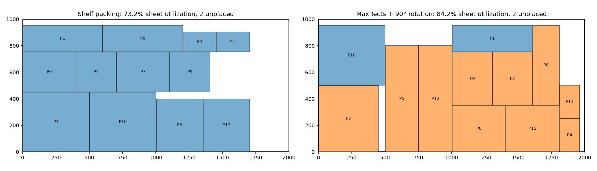
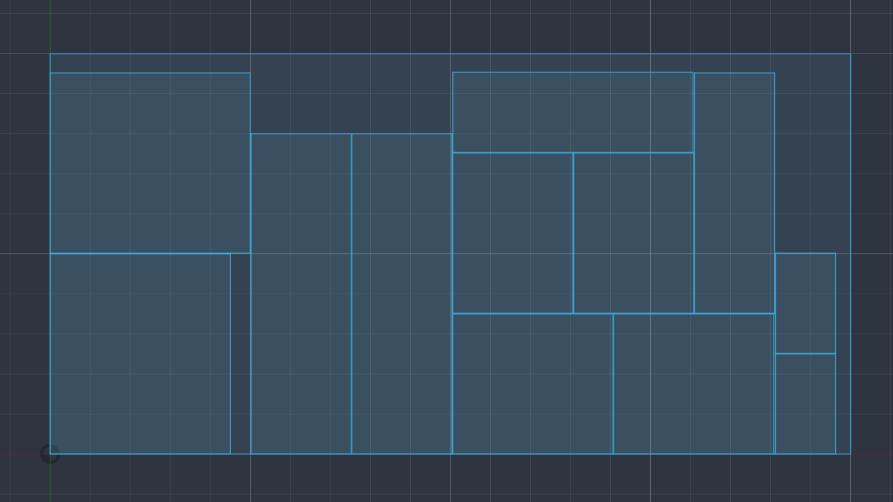

# Laser Nesting Optimizer

A Python tool that arranges rectangular sheet-metal parts on a laser-cutting sheet
to minimize material waste, and exports the result as a DXF file ready for CAD/CAM
(tested in Autodesk Fusion).



## Results

Same 14 parts on a standard 2000 × 1000 mm sheet, 2 mm gap between parts:

| Algorithm | Parts placed | Sheet utilization |
|---|---|---|
| Shelf packing (baseline) | 12 / 14 | 73.2% |
| **MaxRects + 90° rotation** | **12 / 14** | **84.2%** |

**+11 percentage points** of material utilization on the same sheet.

## Features

- **Two nesting algorithms**
  - *Shelf packing*: simple row-based baseline.
  - *MaxRects (Best Short Side Fit)*: tracks every free rectangle on the sheet and
    tries each part in both orientations, placing it where it fits tightest.
- **Kerf / minimum gap** between parts, configurable.
- **DXF export** on separate layers (`FOAIE` sheet outline, `TAIERE` cut contours,
  `ETICHETE` labels), in millimetres, opens directly in Fusion.
- **Visualization** of the layout with matplotlib (rotated parts in orange).
- **98 automated tests** (pytest): no part leaves the sheet, no overlaps, gap is
  respected, no part is lost, MaxRects never does worse than the baseline.

## DXF opened in Fusion



## Quick start

```bash
git clone https://github.com/marc22w/laser-nesting-optimizer.git
cd laser-nesting-optimizer
python3 -m venv .venv && source .venv/bin/activate
pip install -r requirements.txt

python main.py          # runs both algorithms, plots them, exports nesting_maxrects.dxf
python -m pytest -q     # runs the test suite
```

## Project structure

```
nesting/
  models.py       # Part and Placement data classes
  packer.py       # shelf packing (baseline)
  maxrects.py     # MaxRects algorithm with rotation
  plot.py         # matplotlib visualization
  export_dxf.py   # DXF export with ezdxf
tests/            # pytest suite
main.py           # demo: compare algorithms and export DXF
make_figures.py   # generates docs/comparison.png
```

## Roadmap

- [ ] Import parts from DXF files instead of hard-coded dimensions
- [ ] Irregular (non-rectangular) part shapes with Shapely
- [ ] Genetic algorithm to optimize part order and orientation
- [ ] Multi-sheet nesting and cutting-time estimate
- [ ] Parametric perforated-panel generator

## Tech stack

Python · NumPy · Shapely · ezdxf · matplotlib · pytest

## Author

Marc Vintila — Precision Engineering student, Technical University of Cluj-Napoca
